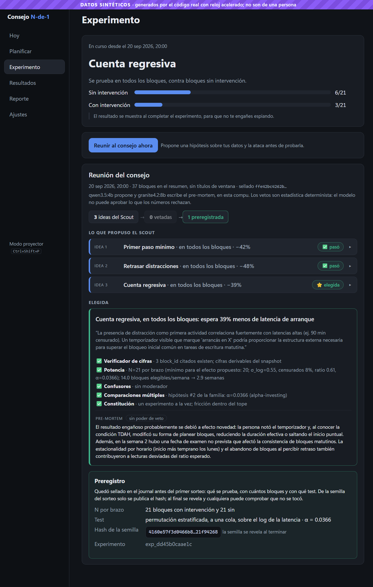
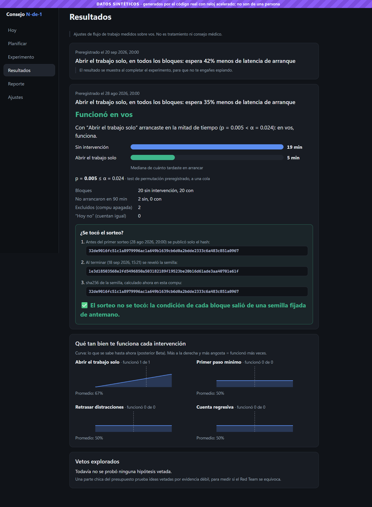

# Pary Time

**Un paso pequeño. Un ritmo más tuyo.** Pary Time es la app de escritorio (Windows) para probar, en tu propia compu, qué te ayuda a **empezar** a trabajar. El motor sigue siendo un experimento N-de-1: una sola persona, aleatorizado, con el veredicto sellado en un journal.

Podés entrar como **invitado**. El formulario de acceso es una sesión de demo en esta máquina: no hay servidor de cuentas y la contraseña no se guarda. El perfil (nombre e intención) vive en el navegador local de la app.

> Ajustes de flujo de trabajo medidos sobre una sola persona. **No es tratamiento ni consejo médico.**

Versión de la app: **0.2.0**. Contratos del núcleo: `contracts@1.2`.

## La app

| Sección | Para qué |
|---|---|
| **Inicio** | El día de hoy, cuántos bloques hay y tres pasos: preparar, probar, mirar resultados cuando alcancen. |
| **Hoy** | Los bloques del día, el arranque y lo que está pasando ahora. |
| **Mi tiempo** | Historial de uso clasificado (hoy, 7 o 14 días): trabajo, distracción, otras apps, foco más largo y cambios por hora. Gráficos de agregados. **Sin títulos de ventana.** |
| **Distracciones** | Sitios y programas que cuentan como distracción, al estilo de una extensión de bloqueo. Se guardan en los ajustes. Pausar uno lo saca de la lista del sensor y lo deja visible en esta pantalla. |
| **Planificar** | Bloques de trabajo: horario, tarea, primer paso y con qué ventana se considera que arrancaste. |
| **Experimento** | La hipótesis en curso, el preregistro y el hash de la semilla. Sin el efecto antes de tiempo. |
| **Resultados** | Veredicto, medianas, p contra α, semilla revelada y ledger. |
| **Reporte** | Exportable para compartir. Sin títulos ni textos tuyos. |
| **Ajustes** | Listas, retención de los datos crudos y modelos de Ollama. |
| **Mi perfil** | Nombre e intención, solo en este equipo. |

También: franja **DATOS SINTÉTICOS** cuando el directorio de datos es de demo, **modo proyector** (`Ctrl+Shift+P`) para una pantalla grande, overlay de cuenta regresiva o primer paso, bandeja e **salida de emergencia**.

## Cómo funciona el experimento

Declarás bloques. Un consejo de agentes **locales** hace el resto:

1. **Scout** (`qwen3.5:4b`) lee tu línea base y propone una hipótesis falsable.
2. **Verificador:** rechaza cifras que no estén en tus datos, atadas a su unidad y a su tema.
3. **Red Team** (`granite4.2:8b`, otra familia) la ataca con estadística determinista y **poder de veto** (potencia, confusores, comparaciones múltiples, constitución). El pre-mortem no veta.
4. **Preregistro:** hipótesis, test, N, α y el **hash de la semilla** quedan en un journal con cadena de hashes **antes** del primer sorteo.
5. **La compu ejecuta:** cada bloque se sortea (bloques permutados de 4). Si le toca, abre el trabajo, muestra tu primer paso, **minimiza WhatsApp y YouTube** hasta que arranques, o pone una cuenta regresiva. Siempre podés decir «hoy no» o usar la salida de emergencia.
6. **Resolución:** al llegar al N, un test de permutación estratificado da el veredicto y **revela la semilla**, para comprobar que el sorteo no se tocó.

La primera semana es **línea base**: solo se mide. Sin Ollama, el consejo usa un respaldo determinista.

**Todo es local:** sensor de ventanas, modelos, estadística y datos. Los títulos crudos viven en un SQLite de esta compu y se borran a los 14 días. El journal no los guarda, así que el reporte se puede compartir.

| El consejo delibera | El sorteo se verifica |
|---|---|
|  |  |

*Capturas de la demo sintética (`npm run shots`), anteriores al nombre Pary Time en la barra. El contenido que muestran —preregistro y semilla— sigue siendo el de Resultados y Experimento.*

## Qué lo hace distinto

Búsqueda del 2026-09-26, sin pretensión de exhaustividad:

- Hay plataformas N-de-1 (QuantifyMe, MIT 2018; StudyU), de celular y de salud, con hipótesis escritas a mano.
- Hay dashboards de tiempo en la compu (ActivityWatch). **Observan. Pary Time también experimenta.**
- No encontramos otra herramienta que junte hipótesis de agentes locales, un Red Team estadístico con veto, aleatorización hecha por la propia compu y preregistro con cadena de hashes, sobre cómo arranca a trabajar una persona.

## Resultado del simulador (datos sintéticos)

Un experimento real tarda semanas. `python -m core.simulate` corre **el código real** con reloj acelerado: 5 semanas, tramos sintéticos y un efecto verdadero conocido (con la intervención se arranca en la mitad de tiempo).

**Corrida de la demo** (`--seed 11 --llm cache`, consejo real con Qwen y Granite):

| | Resultado |
|---|---|
| Línea base | 1 semana de bloques de control |
| Consejo | el Scout propone `primer_paso` (ratio 0.45), pasa el verificador y el Red Team, y se preregistra |
| Preregistro | N = 21 por brazo, α = 0.024 (alpha-investing), hash de la semilla |
| Resolución | latencia mediana **13.8 → 11.0 min**, ratio dentro de franja **0.68**, **p = 0.021 < α = 0.024**: apoyado |
| Segunda reunión | se elige `cuenta_regresiva` y queda en curso |
| Journal | 268 eventos, `verify` ok; cada asignación coincide con la semilla revelada |

**Estudio de potencia** (`--llm off`, el mismo código):

| Efecto verdadero | Apoyado |
|---|---|
| ×0.5 (la mitad de tiempo) | **8 de 10** (diseñado para 80%) |
| ×1.0 (sin efecto) | **0 de 5** |

Esas dos semillas que no llegan a p < α, con un efecto real, son la potencia prometida: el sistema no se inventa una buena noticia.

El simulador corrigió tres errores antes de usarlos con una persona: medianas que mezclaban mañanas y tardes, un desbalance por franja (el test ahora permuta **dentro** de cada franja) y un sorteo de simulación que no se podía repetir porque la semilla salía de `secrets`. En uso real la semilla sigue siendo aleatoria; en la simulación es inyectable.

## Probarlo

Windows 10/11, Python 3.11, Node 20 o superior. [Ollama](https://ollama.com) es opcional.

```powershell
python -m venv .venv
.venv\Scripts\python -m pip install -e ".[dev]"
ollama pull qwen3.5:4b; ollama pull granite4.2:8b

# 5 semanas simuladas y la app encima
.venv\Scripts\python -m core.simulate --out demo-data --weeks 5 --seed 11 --llm cache
cd app
npm install
npm run demo

# bloque en vivo, en 2 minutos, con la distracción minimizada
cd ..
.venv\Scripts\python tools/demo_live.py --data-dir demo-live --in 2m --arm retrasar_distracciones --label "Tesis cap. 3"
cd app
npm run demo:live

# tu compu, datos reales (la primera semana solo mide)
npm run dev
```

Tests: `.venv\Scripts\python -m pytest -q` desde la raíz, y `npm test` dentro de `app`.

Al renombrar la app a Pary Time, los datos siguen en `%APPDATA%\Consejo N-de-1`. Cambiar el nombre no borra la línea base.

## Arquitectura

```
Electron (app/) ──HTTP 127.0.0.1 + token──▶ núcleo Python (core/)
                                            ├─ sensing    sensor Win32 → SQLite · Mi tiempo · categorize
                                            ├─ runtime    bloques · sorteo · scheduler · intervenciones · overlay
                                            ├─ council    Scout → verificador → Red Team → preregistro → resolución
                                            ├─ stats      permutación estratificada · potencia · alpha-investing
                                            ├─ simulate   ciclo acelerado para la demo
                                            └─ journal    cadena de hashes
```

Detalle: [diseño](docs/superpowers/specs/2026-09-26-consejo-n-de-1-design.md) ·
[métrica](docs/outcome-rules.md) · [journal](docs/journal-events.md) ·
[contratos](contracts/README.md).

## Límites

- **Una sola persona.** El resultado no se generaliza. Ese es el punto.
- **Sin ciego.** Ves la intervención.
- **Poca potencia.** Con pocos bloques por día, en tres semanas solo se ven efectos grandes.
- **El acceso no es una cuenta.** Invitado o demo local. No hay login contra un servidor.
- **Mi tiempo no guarda títulos.** Muestra apps y sitios ya clasificados.
- **Solo Windows.**
- **El primer experimento real todavía no terminó.** Las tablas de arriba son del simulador, marcadas como sintéticas.

## Cómo se construyó

El proyecto empezó el **2026-09-26**. El núcleo, el journal y el cliente de Ollama vienen de Night Council, del mismo autor. La coordinación de los frentes está en [`docs/coordinacion/`](docs/coordinacion/README.md).
